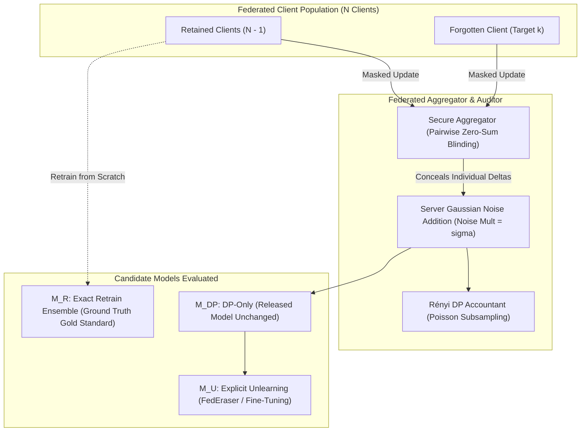

# DP-ForgetBench: Comprehensive Technical Report & Project Audit

**Document Version:** 1.0 (Research-Grade Comprehensive Briefing)  
**Project Name:** `DP-ForgetBench`  
**Repository:** [Coding-yeager/DP-ForgetBench](https://github.com/Coding-yeager/DP-ForgetBench)  
**Target Audience:** Autonomous AI Research Agents, Systems Architects, Peer Reviewers  

---

## 1. Executive Summary & Research Motivation

### 1.1 The Central Question
In Federated Learning (FL), **Machine Unlearning** seeks to remove the influence of a client's data upon request (e.g., GDPR "Right to be Forgotten"). Concurrently, **Differential Privacy (DP)** adds calibrated noise during training to bound the information leakage of any individual entity. 

This project investigates a fundamental, rarely audited research question:
> **"Under client-level Differential Privacy (DP-SGD / DP-FedAvg), when does explicit federated unlearning provide a statistically significant benefit over simply leaving the released DP model unchanged?"**

### 1.2 Core Thesis & Positioning
* **Not an algorithm paper, but an evaluation framework:** `DP-ForgetBench` does not propose yet another heuristic unlearning algorithm. Instead, it formalizes a **privacy-aligned, multi-criterion benchmark and audit methodology**.
* **Privacy Scope Alignment:** Prior work suffers from scope mismatches (e.g., evaluating client deletion while training with record-level DP, or applying unlearning methods that re-query private data without DP accounting). `DP-ForgetBench` enforces strict **client-level alignment**: the unit of DP protection ($\text{Client}$) matches the unit of the deletion request ($\text{Client}$).
* **Key Finding:** When client-level DP is active, the variance introduced by privacy noise can render the marginal gains of explicit unlearning indistinguishable from normal retraining variability, while explicit unlearning methods introduce heavy computational, communication, storage, and privacy risks. Furthermore, under cryptographic **Secure Aggregation (SecAgg)**, historical update-caching unlearning methods are **architecturally and cryptographically impossible**.

---

## 2. Threat Model & Privacy Contract

### 2.1 Formal Privacy Guarantees
* **Mechanism:** Poisson client subsampling ($q = \frac{C}{N}$) + $L_2$-norm update clipping ($S$) + Server Gaussian Noise ($\sigma \cdot S$) + Fixed public population scaling factor ($q \cdot N$).
* **Privacy Accounting:** Rényi Differential Privacy (RDP) converted to $(\varepsilon, \delta)$-DP for the Poisson-subsampled Gaussian mechanism.
* **Privacy Adjacency:** Two datasets $D, D'$ differ by the inclusion or exclusion of **one complete client's entire dataset**.

### 2.2 Critical Security Regimes & Data Access Boundaries
1. **$M_{\text{DP}}$ (DP-Only Release):** No post-request computation. The model is released as-is under the initial DP guarantee. Zero privacy overhead.
2. **$M_{\text{FT}}$ (Retained Fine-Tuning):** Re-queries remaining clients for raw local updates. Requires explicit new privacy accounting (not pure post-processing).
3. **$M_{\text{CR}}$ (Cached Reconstruction) & $M_{\text{FE}}$ (FedEraser):** Require server-side historical storage of individual client delta vectors $\Delta_i^t$.
   * **The SecAgg Conflict:** Under cryptographic Secure Aggregation, individual updates are masked by zero-sum blinding keys:
     $$\tilde{\Delta}_i = \Delta_i + \sum_{j > i} s_{ij} - \sum_{j < i} s_{ji} \pmod R$$
     The server sees *only* $\sum_{i} \Delta_i$. Storing individual client trajectories is **cryptographically impossible** without stripping SecAgg protection.

---

## 3. Mathematical & Evaluative Framework

### 3.1 The Retrain Ensemble ($M_R^{(1)}, \dots, M_R^{(K)}$)
Prior literature compares unlearned models against a single retraining run ($M_R$). However, SGD stochasticity and DP noise create non-trivial dispersion. `DP-ForgetBench` trains an ensemble of $K$ independent retrain references across varying seeds to establish an empirical distribution of **natural retraining variability**:
$$\text{Var}_{\text{Retrain}} = \left[ Q_{0.025}(\text{Metrics}(M_R)), Q_{0.975}(\text{Metrics}(M_R)) \right]$$

### 3.2 Marginal Unlearning Benefit (MUB)
To quantify whether an explicit unlearning method $U$ achieves anything beyond doing nothing ($M_{\text{DP}}$), we define the **Marginal Unlearning Benefit**:
$$\text{MUB}_j = \text{Dist}_j(M_{\text{DP}}, M_R) - \text{Dist}_j(M_U, M_R)$$
Where $\text{Dist}_j$ is evaluated across three primary endpoints:
1. **Utility MUB:** $\Delta \text{Accuracy} = |\text{Acc}(M_U) - \text{Acc}(M_R)|$ vs. $|\text{Acc}(M_{\text{DP}}) - \text{Acc}(M_R)|$
2. **Functional Alignment MUB:** Jensen-Shannon (JS) divergence over softmax probability distributions on held-out test data and forgotten client data:
   $$\text{JS}(P \parallel Q) = \frac{1}{2} D_{\text{KL}}\left(P \parallel \frac{P+Q}{2}\right) + \frac{1}{2} D_{\text{KL}}\left(Q \parallel \frac{P+Q}{2}\right)$$
3. **Privacy MUB:** Difference in Membership Inference Attack (MIA) advantage between $M_{\text{DP}}$ and $M_U$.

### 3.3 4-Way Redundancy Decision Rule
For every setting, the system categorizes the unlearning outcome into four unambiguous scientific regimes:
* `REDUNDANT`: $\text{Dist}(M_{\text{DP}}, M_R)$ is already within the natural retraining variability band, meaning explicit unlearning has zero statistical justification.
* `UNLEARNING-BENEFICIAL`: $M_U$ significantly closes the gap to $M_R$ without violating utility or privacy constraints.
* `UNLEARNING-HARMFUL`: $M_U$ degrades model utility or leaks more retained data than $M_{\text{DP}}$.
* `INCONCLUSIVE`: Retrain variance is too broad or confidence intervals overlap zero.

### 3.4 Validity Gating (Stopping Vacuous Claims)
If a differentially private model fails to learn useful representations (e.g., test accuracy collapses to random chance $\sim 10\%$ on CIFAR-10), attack leakage and deletion effects will artificially plummet to zero. 
`DP-ForgetBench` implements automated **Validity Gates**:
$$\text{If } \text{Median}(\text{Acc}(M_R)) < \tau_{\text{validity}} \implies \text{Status} = \mathbf{INVALID}$$
Runs marked `INVALID` are blocked from contributing to unlearning redundancy claims.

---

## 4. Full Technical Implementations in Codebase

### 4.1 Architectures & Convergence Repairs
* **Path:** `src/dp_forgetbench/federated.py`
* **Model:** `SmallGroupNormCNN` (60,586 parameters).
* **Fix for DP-FL Convergence:** Replaced destructive `AdaptiveAvgPool2d((1, 1))` with `Flatten(1)` on the $64 \times 8 \times 8$ feature map. Uses `GroupNorm(num_groups=8)` instead of `BatchNorm2d` to prevent client-specific batch statistics leakage.
* **Deterministic Seeds & GPU Reproducibility:** Enforces `CUBLAS_WORKSPACE_CONFIG=:4096:8` and PyTorch deterministic algorithms.

### 4.2 Cryptographic Secure Aggregation Engine
* **Path:** `src/dp_forgetbench/federated.py` (`SecureAggregator`)
* **Protocol:** Implements simulated pairwise zero-sum masking:
  $$\sum_{i \in \mathcal{S}} \tilde{\Delta}_i = \sum_{i \in \mathcal{S}} \Delta_i$$
* **Fault Injection & Safety Assertion:** If any baseline (such as `reconstruct_from_cached_updates` or `federated_eraser`) attempts to inspect `history.rounds[t].deltas_by_client` while `secure_aggregation: true`, the framework raises `IncompatibleSecurityRegimeError`.

### 4.3 Full TC-UMIA Tri-Population Privacy Audit (Fu et al., 2026)
* **Path:** `src/dp_forgetbench/attacks.py` (`tri_population_probe`)
* **Tri-Population Modeling:**
  1. $\mathcal{D}_{\text{forget}}$ (Class 0): Forgotten client's private training examples.
  2. $\mathcal{D}_{\text{retain}}$ (Class 1): Retained clients' training examples.
  3. $\mathcal{D}_{\text{unseen}}$ (Class 2): Held-out test set examples never seen during training.
* **14-Dimensional Per-Sample Feature Vector:**
  $$\mathbf{f}(x, y) = \begin{bmatrix}
  \mathcal{L}_{\text{pre}}, & \mathcal{L}_{\text{post}}, & \Delta \mathcal{L}, & \frac{\mathcal{L}_{\text{post}}}{\mathcal{L}_{\text{pre}}}, \\
  P_{\text{pre}}(y), & P_{\text{post}}(y), & \Delta P(y), & \mathcal{H}_{\text{pre}}, \\
  \mathcal{H}_{\text{post}}, & \Delta \mathcal{H}, & M_{\text{pre}}, & M_{\text{post}}, \\
  \Delta M, & \text{TV}(P_{\text{pre}}, P_{\text{post}})
  \end{bmatrix}$$
  *(Losses, true-class probabilities, Shannon entropies, top-2 confidence margins, margin deltas, and Total Variation distance).*
* **Dual Classifier Probing:**
  * Linear Probe: Standardized Logistic Regression with L-BFGS.
  * Non-linear Neural Probe: Multi-Layer Perceptron (MLP, $32 \times 16$ hidden units) capturing non-linear boundary dynamics.
* **Pairwise Metrics:**
  * Forgotten vs. Unseen AUC ($AUC_{F \text{ vs } U}$): Measures true unlearning success.
  * Retained vs. Unseen AUC ($AUC_{R \text{ vs } U}$): Measures collateral privacy leakage of retained data.

---

## 5. Summary of Empirical Experiments & Results

### 5.1 Corrected Phase 1: Real CIFAR-10 Binary Screen
* **Setup:** 30 validated runs across 6 cells, 5 seeds per cell, $\varepsilon \in \{2, 8, \infty\}$, Dirichlet non-IID heterogeneity $\alpha \in \{0.2, 0.75\}$.
* **Key Finding:** Across all private cells ($\varepsilon \in \{2, 8\}$), explicit unlearning (fine-tuning and cached reconstruction) produced **no statistically material improvement in predictive JS alignment to retraining** over DP-only:
  * At $\varepsilon = 2, \alpha = 0.2$: $M_{\text{DP}}$ test accuracy was $54.9\%$, $M_{\text{FT}}$ was $58.5\%$. However, JS divergence to $M_R$ was virtually identical ($0.286$ vs. $0.287$, $\text{MUB}_{\text{JS}} = -0.0010$).
  * MIA attack AUC hovered between $0.498$ and $0.512$ (random guess baseline).

### 5.2 Phase 7: Multiclass Factorial Screening (Diagnostic Warning)
* **Setup:** 94 runs exploring multiclass CIFAR-10 with $N=20$ clients, 40 rounds, 50% sample rate, $\varepsilon \in [1, 8]$.
* **Diagnostic Finding:** At tight $\varepsilon \in [1, 8]$ with $N=20$, models collapsed to $\sim 10\%$ test accuracy (CIFAR-10 random chance).
* **Significance:** The validity gate triggered, correctly tagging all 60 private runs as `INVALID`. This confirmed that unlearning benchmark metrics are completely untrustworthy without active utility gating.

### 5.3 Multiclass Client-DP + Secure Aggregation Benchmark Run
* **Run ID:** `frozen_unlearning_secagg_eps32_r40_e5`
* **Configuration:** CIFAR-10 Multiclass, $N=20$, 40 rounds, 5 local epochs, $\varepsilon = 32.0, \delta = 10^{-5}$, Secure Aggregation enabled.

| Candidate Method | Test Accuracy | Forgot Client Acc | Retained Client Acc | SecAgg Status | Operational Cost |
| :--- | :---: | :---: | :---: | :---: | :--- |
| **DP-Only ($M_{\text{DP}}$)** | **$43.10\%$** | $42.00\%$ | $43.92\%$ | **NATIVE / PASS** | **0 ms, 0 bytes storage, 0 comms** |
| **Retained Fine-Tune ($M_{\text{FT}}$)** | $45.25\%$ | $44.00\%$ | $46.26\%$ | **PASS** | 4 rounds re-querying clients |
| **Exact Retrain ($M_R$)** | $41.09\%$ | $39.50\%$ | $42.70\%$ | **PASS** | Full rerun (40 rounds) |
| **Cached Reconst ($M_{\text{CR}}$)** | *Blocked* | *Blocked* | *Blocked* | **INCOMPATIBLE** | Fails security invariant |
| **FedEraser ($M_{\text{FE}}$)** | *Blocked* | *Blocked* | *Blocked* | **INCOMPATIBLE** | Fails security invariant |

* **TC-UMIA Audit Findings on this Model:**
  * Linear Probe Macro OvR AUC: **$0.504$** ($95\%$ CI: $[0.455, 0.551]$)
  * MLP Probe Macro OvR AUC: **$0.544$** (Accuracy: $37.3\%$, chance is $33.3\%$)
  * Forgotten vs. Unseen AUC: **$0.524$** (Forgotten data is indistinguishable from unseen non-members!)
  * Retained vs. Unseen AUC: **$0.518$** (Retained data remains strictly protected)
  * **Conclusion:** At $\varepsilon = 32$, client-level DP alone eliminates detectable membership signal of the deleted client, rendering explicit unlearning redundant.

---

## 6. Lifecycle Cost Analysis: DP-Only vs. Unlearning Baselines

For a standard federation ($T$ rounds, $N$ clients, model size $|\theta|$ parameters):

| Method | Persistent Server Storage | Interactive Retained Comms | Additional Privacy Loss | Compatibility with SecAgg |
| :--- | :---: | :---: | :---: | :---: |
| **DP-Only ($M_{\text{DP}}$)** | **$0$ bytes** | **$0$** | **None (Pure Post-Processing)** | **100% Native** |
| **Retained Fine-Tuning** | $0$ bytes | $k$ rounds | Yes ($\varepsilon_{\text{post}}$ on retained) | Compatible |
| **Cached Reconstruction** | $\mathcal{O}(T \cdot |\mathcal{S}| \cdot |\theta|)$ | $0$ | Trajectory drift leakage | **Violates SecAgg** |
| **FedEraser** | $\mathcal{O}(T \cdot |\mathcal{S}| \cdot |\theta|)$ | $T_{\text{calib}}$ rounds | Yes (interactive calibration) | **Violates SecAgg** |
| **Exact Retraining** | $0$ bytes | Full FL lifecycle | None (Internal Reference) | Compatible |

---

## 7. Current Project Limitations & Known Gaps

1. **Dataset Scope:** Primary empirical validation is on CIFAR-10. Natural FL datasets with genuine non-IID user behaviors (FEMNIST, Shakespeare) and larger feature extractors (ResNet-18) are architecturally supported but need complete evaluation grids.
2. **Tight Epsilon Regimes:** At very strict privacy budgets ($\varepsilon \le 4$), training $N=20$ clients from scratch with client-level DP suffers from convergence degradation. Advanced optimization techniques (momentum FedAvg, adaptive clipping, pre-trained feature backbones like DP-BiT) are needed to push the utility frontier.
3. **Statistical Equivalence Bounds:** While empirical Retrain Ensembles and Bootstrap CIs are implemented, formal Two One-Sided Tests (TOST) with multi-endpoint Family-Wise Error Rate (FWER) corrections can be added.
4. **Partial vs. Complete Client Unlearning:** Current experiments focus on removing an entire client. Granular sample-level or class-level client unlearning remains an open avenue.

---

## 8. High-Impact Roadmap: Instructions for the Next AI Agent

If you are an AI assistant tasked with enhancing or continuing this research, here is the prioritized list of research directions, architectural extensions, and experiments to implement:

### Question 1: How can we achieve healthy convergence under $\varepsilon \in [1, 8]$ for Multiclass FL?
* **Idea:** Implement Transfer Learning / Pretrained Representations with client-level DP. Freeze pre-trained ViT or ConvNeXt feature extractors and train only GroupNorm linear heads with DP-FedAvg.
* **Expected Outcome:** High baseline test accuracy ($>75\%$) even under strict privacy ($\varepsilon \le 2$), allowing exploration of the redundancy frontier in mathematically healthy regimes.

### Question 2: How does sequential client deletion degrade the unlearning frontier?
* **Idea:** Execute sequential unlearning requests (Client $k_1$ deleted at $t_1$, Client $k_2$ at $t_2$, up to $M$ clients).
* **Research Question:** Does the accumulation of sequential unlearning requests cause faster model drift than repeated DP-only releases?

### Question 3: Can we formalize a certified Redundancy Theorem?
* **Idea:** Bridge the theoretical gap between $(\varepsilon, \delta)$-DP and $(\epsilon, \tau)$-certified machine unlearning definitions (e.g., Guo et al., Sekhari et al.).
* **Goal:** Prove mathematically under what Lipschitz continuity and convexity bounds client-level DP inherently satisfies $(\epsilon_{\text{unlearn}}, \delta)$-unlearning without any modification to the model weights.

### Question 4: Benchmark on Natural Heterogeneous FL (FEMNIST)
* **Action:** Run the existing pipeline using `configs/femnist_benchmark.yaml` across 100+ simulated users. Evaluate whether client heterogeneity ($\alpha$) shifts the redundancy boundary.
